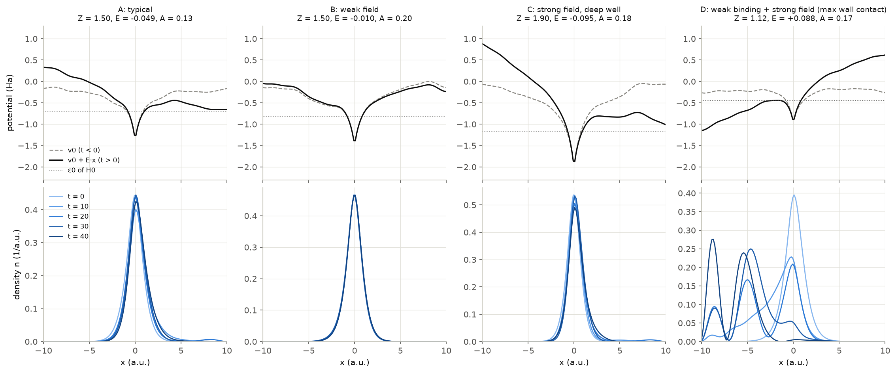
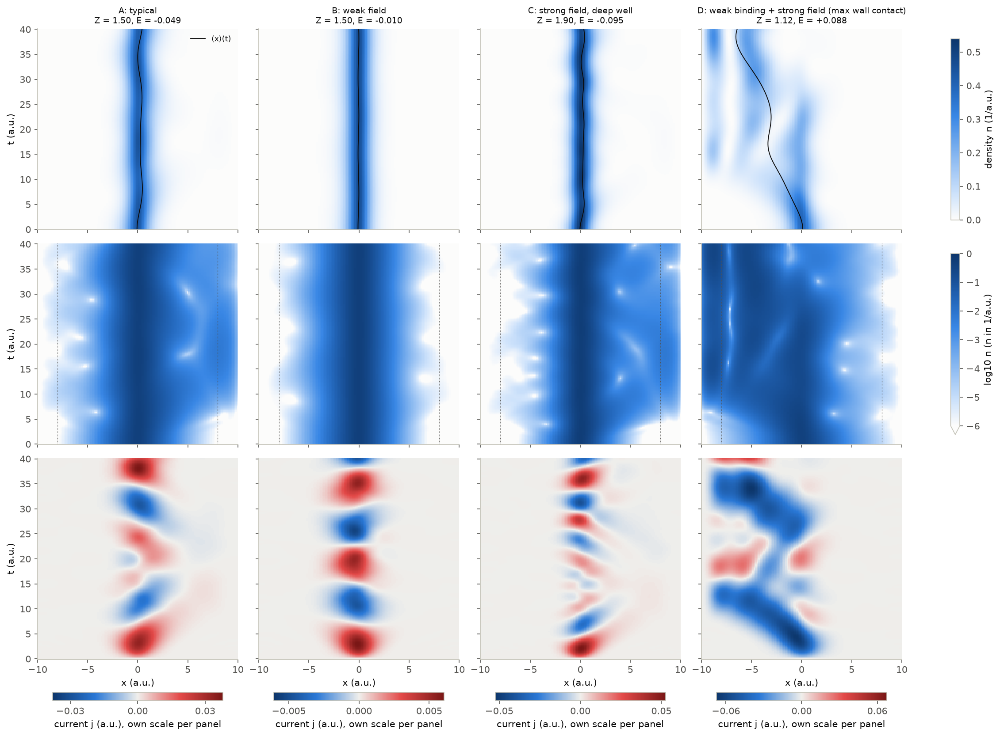
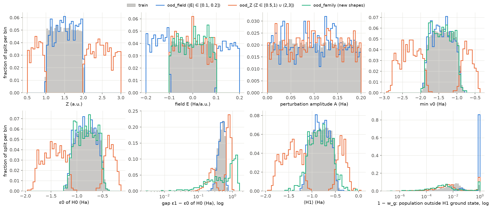
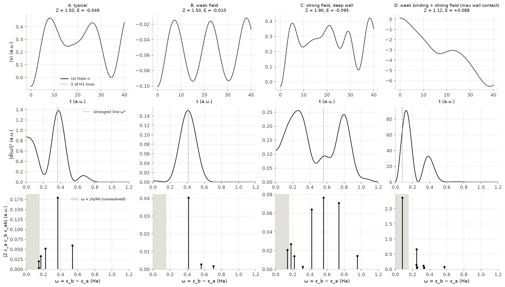
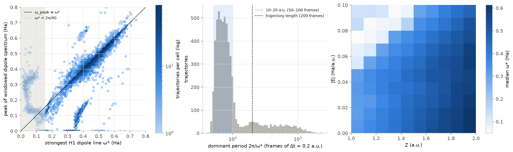
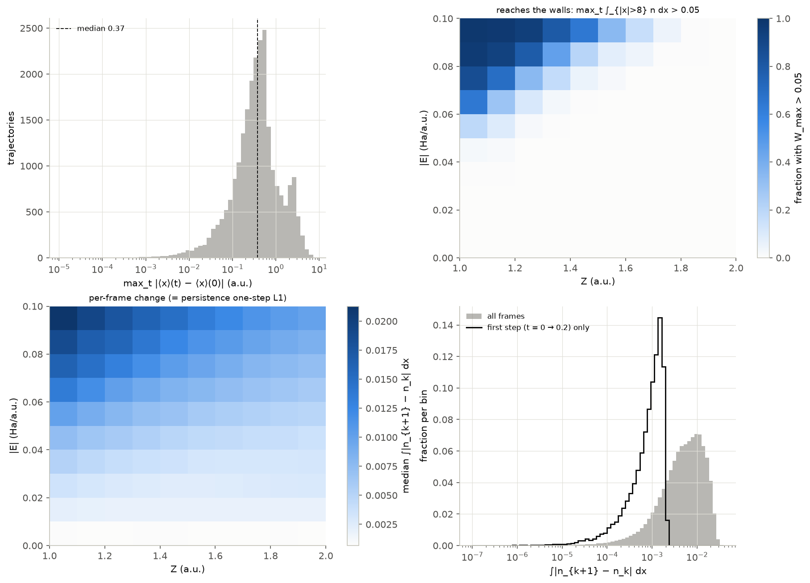
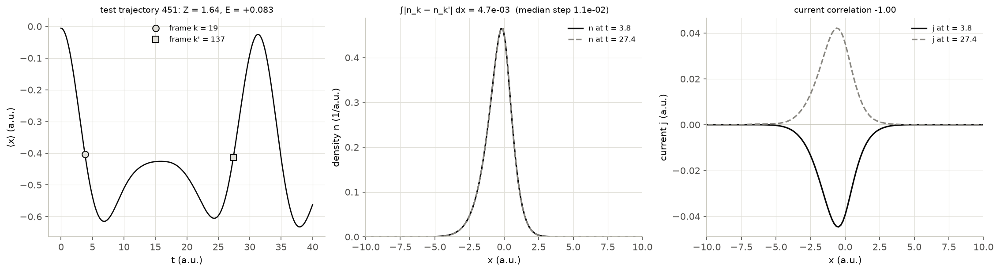
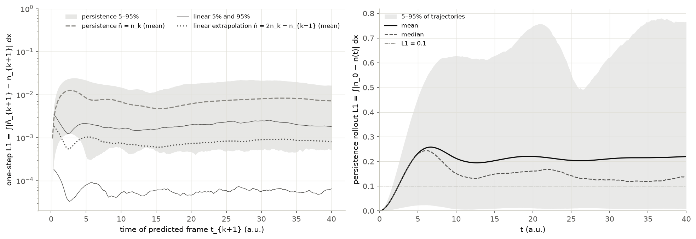
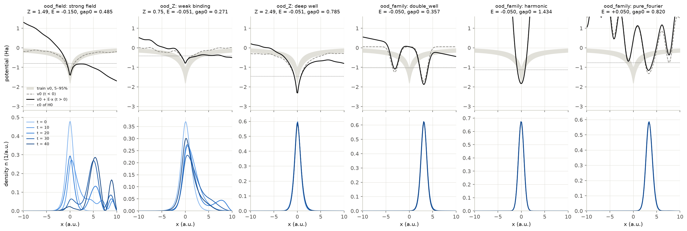
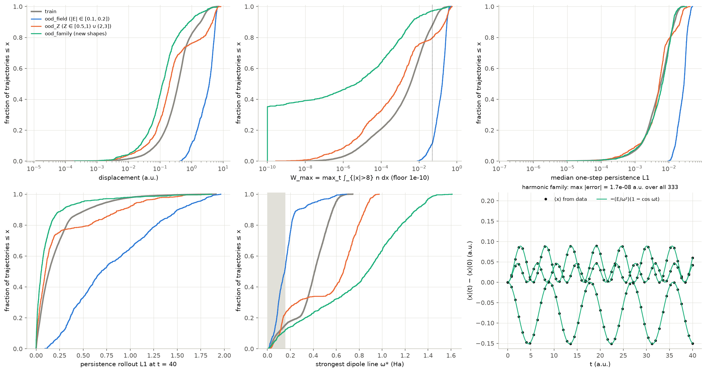

# LQM-1e dataset: exact one-electron density dynamics

*Report 1 of the LQM-1e project. It describes the training and evaluation data only; there are no model results here.*

**Regenerate:** `python scripts/report_dataset.py` (about 1 min on the i9). It rewrites every figure in `figures/01_*.png` and every number quoted below in `01_dataset_numbers.json`. The validation numbers come from `data_checks.json`, written by `scripts/validate_data.py`.
**Provenance:** data written from git commit `3feb184d…`, iDEA 1.1.0. The files are stamped `-dirty`, but only untracked files (this report, notes) differed; all tracked code was committed. `git_hash` has since been fixed to ignore untracked files (see [Open items](#7-open-items)). Atomic units throughout: lengths in Bohr, times in ħ/Ha, energies and frequencies in Ha, fields in Ha/Bohr.

## At a glance

- **36 000 exact trajectories** in 6 splits, 6.81 GB in total: 24 000 train, 3 000 val, 3 000 test, and 1 000 each in three out-of-distribution (OOD) sets. Each trajectory is a 1D electron density n(x, t) on 128 grid points × 201 frames (Δt = 0.2, t ≤ 40), which gives 4.8 M input→target frame pairs for training.
- **The data are exact to machine precision.** In float64, norm, energy, continuity and zero wall flux all hold to ≤ 6e-15 (continuity, checked by finite differences, to ≤ 5e-9). All 64 trajectories per split that were regenerated from their seeds are bit-identical to the stored ones. Every validation check passes. The parity check uses a conditioning-aware tolerance, because one near-degenerate `ood_family` double well missed a flat 1e-12 tolerance through round-off (§3.2).
- **The motion is small but not trivial.** In training, the median displacement of ⟨x⟩ is 0.37 a.u. and the median per-frame change is ∫|n_{k+1} − n_k| dx = 0.0054. For 74% of training trajectories the dominant dipole period is 10–20 a.u. (50–100 frames), so a trajectory shows only about 2–3 oscillations.
- **There is a heavy tail.** 12% of training trajectories push more than 5% of the electron into |x| > 8, the last 2 a.u. before the hard walls. 97% of them have |E| > 0.06, and in the weak-binding, strong-field corner (Z < 1.2, |E| > 0.08) almost every trajectory does. In 61% of them the ground state of the tilted Hamiltonian H1 sits near a wall, so the atom-like state is a metastable resonance that leaks out.
- **A frame is not a state.** In 34% of test trajectories (first 1 000), two frames at least 2 a.u. apart have densities closer than one typical time step, yet carry nearly opposite currents. A model has to infer the velocity from the history.
- **The bar to beat.** Persistence (n̂_{k+1} = n_k) has a median one-step L1 of 0.0056 on test, but its free rollout already exceeds L1 = 0.1 at a median t = 2.6 a.u. Linear extrapolation cuts the one-step error by a factor of 8.6. If one-step errors simply added up, staying below 0.1 for 200 steps would need a one-step L1 below 5e-4, which is better than linear extrapolation's median of 6.5e-4.
- **The OOD sets are not equally hard.** `ood_field` is a different dynamical regime rather than a mild extrapolation: 89% of its trajectories reach the walls and its persistence error is 5× the training value. `ood_family` changes the shape of the potential, but by the persistence metric it is *easier* than training. Its ground states are off-centre and its frequencies lie above the training range.

---

## 1. Motivation and background

### 1.1 The physical setup

A single electron in one dimension sits in a box x ∈ [−10, 10] with hard walls. For t < 0 it is in the ground state of a static potential

v0(x) = −Z/(|x| + 1) + δv(x),

which is a softened atom of charge Z ∈ [1, 2] plus a smooth random perturbation δv. The perturbation is a Fourier series with 8 modes and a 1/m roll-off, rescaled to an amplitude max|δv| = A ∈ [0, 0.2] Ha. At t = 0 a uniform field E ∈ [−0.1, 0.1] Ha/Bohr is switched on suddenly and then held fixed, so for t > 0 the potential is v = v0 + E·x. The electron then evolves under the static Hamiltonian H1 = −½∂²_x + v, and we record the exact density n(x, t) = |ψ(x, t)|² every Δt = 0.2 a.u. up to t = 40.

Physically this is a sudden Stark kick. The ground state of H0 is not an eigenstate of H1, so it rings. Its dipole oscillates around the field-shifted equilibrium at the level spacings of H1. If the binding is weak and the field strong, part of the electron spills out of the well and runs into a wall.

### 1.2 Why one electron first

- **Exact data are cheap.** One 128 × 128 diagonalisation of H1 gives ψ(t) at every frame exactly: ψ(t) = U e^{−iεt} Uᵀ ψ0. There is no time-stepping error and no many-body approximation.
- **The hidden state is minimal.** For one electron, ψ = √n e^{iθ}, so the density plus one phase field (equivalently the current j = n ∂_xθ) *is* the full quantum state. A model that predicts n has to carry exactly one piece of hidden information: the velocity field. That makes this a clean test of whether a sequence model can infer it from the history of n.
- **It connects to TDDFT.** By Runge–Gross, for a fixed initial state, v(x, t) and n(x, t) determine each other. Here the initial state is the ground state of v0, so (v0, E) fixes the whole trajectory. Learning the map from (v, n_0) to n(t) is the one-electron limit of the question the project ultimately cares about.
- **Normalisation is testable.** ∫n dx = 1 holds exactly in the data, so any drift in a model is the model's.

### 1.3 Frames as tokens

The mapping onto next-token prediction is:

| LLM | LQM-1e |
|---|---|
| token | one density frame n(·, t_k) ∈ ℝ¹²⁸ (a continuous vector, not a vocabulary index) |
| prompt | the ground-state frame n_0, together with the potential v = v0 + E·x given as conditioning (constant in time) |
| next-token prediction | predict n_{k+1} from n_0 … n_k and v |
| training | teacher forcing over 200 positions per trajectory (24 000 × 200 = 4.8 M pairs) |
| generation | free autoregressive rollout from n_0 for 200 steps |

### 1.4 The key subtlety: n alone does not determine the future

The continuity equation ∂_t n = −∂_x j says the next frame depends on the current j, which is not a function of n. Two physically different states can share the same density but move in opposite directions. Section 5.1 shows that this happens constantly in this dataset. A model must therefore infer j from the history. Two consecutive frames already fix the frame-averaged ∂_t n, and hence (by integrating the continuity equation from a wall) the frame-averaged flux. That is why the planned baselines include models that see two frames (the MLP on a frame pair, and the GPT with an attention window W = 2).

There is one simplification. The ground state ψ0 is real and H1 is real, so j(x, 0) = 0 exactly. ψ(−t) is then the complex conjugate of ψ(t), so n(−t) = n(t): the density is even in time about the switch-on. The first frame plus v is therefore a *complete* initial condition, and the first step is unusually small, because n_1 − n_0 = O(Δt²) rather than O(Δt). Both facts are checked against the data in §3.3.

---

## 2. Generation method

Code: `lqm/physics/` (`potentials.py`, `propagate.py`, `generate.py`); configuration in `configs/data.json`.

- **Grid.** 128 points on [−10, 10] including both end points, so dx = 0.1575. The kinetic operator is iDEA's 13-point finite-difference stencil, truncated at the edges of the matrix. That truncation means ψ vanishes *just outside* the grid, so the end-point densities need not be exactly zero. H0 is taken from `iDEA.methods.non_interacting` and is cross-checked to be identical.
- **Sampling.** Each trajectory has its own `SeedSequence([base_seed, split_id, index])`, so any single trajectory can be regenerated on its own. Draws with gap ε1 − ε0 < 1e-3 Ha are rejected; `ood_family` additionally rejects ground states with density above 1e-6 at the walls.
- **"Exact" means exact for the 128-point lattice.** The data are machine-precision solutions of the *discretised* Schrödinger equation, which is what the model learns. They are not converged to the continuum. The independent audit compared against a 4× finer grid and found ∫|Δn| dx at t = 40 of 0.012 (train[0]) and 0.099 (train[108], Z ≈ 1, E ≈ −0.1), and ε0 off by 2.5e-3 Ha because of the cusp at x = 0 (audit numbers, not in the numbers file). Physics statements about these data should therefore be read as statements about the lattice model.
- **Propagation.** ψ0 is the ground state of H0. H1 = H0 + diag(E·x) is diagonalised once and ψ(t_k) is evaluated spectrally at every frame. Everything is computed in float64; n and j are stored as float32.
- **Current.** With a 13-point stencil, the textbook Im(ψ*∂_xψ) does *not* satisfy the discrete continuity equation. The stored current is the stencil-consistent one, j_{i+½} = −dx Σ_{m≤i} 2 Im(ψ* H1 ψ)_m. It sits on the 127 interior faces, is instantaneous, and is never a model input. A flux head that needs the *frame-averaged* flux should get it from differences of n, not from j.
- **Stored per trajectory.** `n` (201 × 128), `j` (201 × 127), `v0`, `Z`, `E`, `A`, `family`, `seed`, `energy` = ⟨H1⟩, `eps0`, `gap0`, the 16 most-populated H1 levels with their populations (`spec_eps`, `spec_w`), and `norm_err`. The full schema is in the `lqm/io.py` docstring.

| split | N | file (GB) | what changes relative to train |
|---|---|---|---|
| train | 24 000 | 4.955 | (none) |
| val | 3 000 | 0.619 | (none); KS p ≥ 0.065 for Z, E, A, ε0, gap0, min v0 and ⟨H1⟩ vs train |
| test | 3 000 | 0.619 | (none); KS p ≥ 0.36 for the same seven parameters |
| ood_field | 1 000 | 0.207 | \|E\| ∈ [0.1, 0.2] with random sign |
| ood_Z | 1 000 | 0.207 | Z ∈ [0.5, 1) ∪ (2, 3] |
| ood_family | 1 000 | 0.207 | new shapes (double well, harmonic, pure Fourier), scaled and shifted so that min v0 and ε0 match a training draw |

---

## 3. Validation

### 3.1 Checks run by `scripts/validate_data.py`

Norm, j(t = 0) and gap are checked over every trajectory; the other checks run on 64 regenerated trajectories per split. Numbers are maxima.

| split | \|∫n dx − 1\| f32 (all) | \|∫n dx − 1\| f64 | ⟨H1⟩ rel. drift | continuity (rel.) | parity | aliased weight | wall flux | bit-identical | verdict |
|---|---|---|---|---|---|---|---|---|---|
| train | 2.72e-8 | 5.11e-15 | 1.25e-15 | 1.65e-9 | 2.19e-13 | 1.41e-11 | 1.02e-15 | yes | pass |
| val | 2.50e-8 | 4.44e-15 | 1.48e-15 | 1.16e-9 | 2.59e-13 | 1.14e-11 | 8.03e-16 | yes | pass |
| test | 2.46e-8 | 3.78e-15 | 9.90e-16 | 1.83e-9 | 1.74e-13 | 1.39e-11 | 9.29e-16 | yes | pass |
| ood_field | 2.15e-8 | 3.55e-15 | 1.41e-15 | 1.46e-9 | 3.30e-13 | 1.02e-10 | 8.04e-16 | yes | pass |
| ood_Z | 2.80e-8 | 4.89e-15 | 1.79e-15 | 1.71e-9 | 2.24e-13 | 2.90e-11 | 1.50e-15 | yes | pass |
| ood_family | 2.77e-8 | 3.77e-15 | 8.96e-16 | 4.57e-9 | 1.84e-12 † | 3.32e-13 | 1.09e-15 | yes | pass |
| *tolerance* | 1e-6 | 1e-12 | 1e-10 | 1e-6 | max(1e-12, 10 ε‖H1‖ max n / min(gap0, 1)) | 1e-8 | 1e-12 | (exact) | |

† Below its trajectory's conditioning-aware tolerance (worst residual/tolerance ratio 0.13; see §3.2). In every other split no trajectory needed more than the 1e-12 floor (ood_Z: 1 of 64), and the worst ratio is 0.33.

The stored current at t = 0 is exactly 0 in every split. The densities are non-negative (minimum 6.8e-16 in train), and the smallest H0 gap per split is 0.159 (train), 0.194 (val, test), 0.187 (ood_field), 0.064 (ood_Z) and 0.0028 Ha (ood_family). The "continuity" column compares ∂_t n from a central difference (δt = 1e-4) with the divergence of j, so its size is set by the finite difference, not by the data. The "aliased weight" column is the population further than π/Δt = 15.7 Ha above the lowest H1 level, i.e. weight the frame rate cannot resolve. The OOD factor checks (two-sample KS tests against train) all pass: the intended factor moves (p = 0 for |E| in ood_field and for Z, ε0 and min v0 in ood_Z), and all other factors stay above the p = 1e-3 threshold. The lowest of those is Z in ood_field at p = 0.020, which is unremarkable among 9 such "unchanged factor" tests.

### 3.2 The parity item (resolved)

Parity states that (v0(−x), −E) must produce n(−x, t) exactly. On `ood_family` the residual reached 1.84e-12, against an original flat tolerance of 1e-12. **Resolution:** the cause is diagnosed below as round-off amplified by near-degeneracy. The check now uses the first-order perturbation bound as a per-trajectory tolerance, max(1e-12, 10 ε_mach ‖H1‖ max n / min(gap0, 1)), keeping 1e-12 as a floor. With it every split passes: in `ood_family` 11 of 64 checked trajectories have a relaxed tolerance (up to 4.8e-11) and the worst residual/tolerance ratio is 0.13. The analysis that led there follows.

The working hypothesis was round-off growing with ‖H‖, because the harmonic family reaches up to 116.7 Ha at the walls. To check it, this report recomputes the residual on the validator's own 64-trajectory subsample, broken down by family (`parity_diagnostic` in the numbers file). The result **does not support that hypothesis**:

| family (subsample n) | max parity residual | median | max ‖H1‖ (Ha) | over tolerance |
|---|---|---|---|---|
| double well (20) | 1.84e-12 | 5.2e-14 | 143.2 | 1 |
| harmonic (16) | 1.23e-13 | 5.1e-14 | 224.3 | 0 |
| pure Fourier (28) | 1.05e-13 | 5.0e-14 | 166.8 | 0 |

- The single failing trajectory is `ood_family` seed 192, a **double well with gap0 = 0.00284 Ha, the smallest gap in the whole split**. Its ‖H1‖ = 142.5 Ha is the same as for training potentials (max 142.9 Ha). The next-largest residual in the subsample is 1.98e-13.
- Across the subsample the log-residual correlates with log gap0 at −0.53, but with log ‖H1‖ at only −0.08.
- The standard eigenvector perturbation estimate, ε_mach ‖H‖ / gap0 = 1.1e-11 for this trajectory, puts round-off amplified by near-degeneracy at the observed scale.

**Independent audit (added after review).** A separate read-only audit of the pipeline reached the same diagnosis independently. Over 100 double wells, err·gap0/(ε_mach‖H‖) ≤ 1.8; the harmonic wells stay below 1.6e-13 even at ‖H‖ = 235 Ha; adding a constant 110 Ha to v0 changes n by only 5.4e-13; and an independent `expm`-based reference differs from the stored trajectory by 1.3e-12 on seed 192 itself. These figures come from the audit's scripts, not from `01_dataset_numbers.json`. The cause is therefore established as round-off amplified by near-degeneracy. On that basis the flat 1e-12 tolerance was replaced by the conditioning-aware one above.

My reading, which is consistent with the audit: this is the ill-conditioning of the ground state of a near-degenerate double well, not a bug in the propagation. The amplified error (~1e-12) is four orders of magnitude below the float32 storage resolution (unit round-off 6e-8), so the stored n should be unaffected. The physics point is real, though. For such double wells a tiny change in v0 changes the ground state a lot, so these trajectories are intrinsically sensitive, and any OOD error on them should be read with that in mind. Only 64 of 1 000 `ood_family` trajectories were checked, and 6.6% of the double wells have gap0 < 0.05 Ha. A gap-aware tolerance, or a check on all of those small-gap trajectories, would close the item.

### 3.3 Additional physics checks in this report

| check | expectation | measured |
|---|---|---|
| time reversal n(−t) = n(t) (10 test trajectories, float64) | exact for a real ψ0 and real H1 | max difference 0.0 (bitwise) |
| onset ratio ∫\|n_2 − n_0\| / ∫\|n_1 − n_0\| (train) | 4 if ∂_t n(0) = 0 (quadratic onset), 2 if not | median 3.91 (5–95%: 3.88–3.94) |
| sudden switch: ⟨H1⟩ = ε0 + E⟨x⟩_0 | exact | max deviation 1.16e-9 (float32 dipole) |
| ⟨x⟩(t) = Σ_a c_a² x_aa + Σ_{a<b} 2c_a c_b x_ab cos(ω_ab t) (4 examples) | exact | max deviation 2.7e-8 |
| harmonic OOD family: ⟨x⟩(t) − ⟨x⟩(0) = −(E/ω²)(1 − cos ωt) (all 333) | exact (generalised Kohn theorem) | max deviation 1.7e-8; \|gap0 − ω\| ≤ 2.8e-10 |
| persistence metrics vs the evaluation harness (`runs/smoke_persistence`, 256 test trajectories) | identical | one-step mean 0.007037 vs 0.007037; rollout L1 at t = 40, 0.212 vs 0.212 |

The harmonic check is the strongest of these, because it tests the dynamics against an analytic result in an unrelated potential shape. In a parabolic well a uniform field only shifts the centre, so the density oscillates rigidly at exactly ω. The 13-point stencil and the walls (at 116.7 Ha) do not break this visibly.

---

## 4. What is in the dataset

### 4.1 Representative trajectories

The four test-set examples are chosen by fixed criteria. A, B and C are the trajectories nearest to target values of (Z, |E|), with |E| scaled by 0.1; D is the test trajectory with the largest wall mass.

| | criterion | Z | E | A | ⟨x⟩ displacement | W_max |
|---|---|---|---|---|---|---|
| A typical | nearest to (1.5, 0.05) | 1.498 | −0.0494 | 0.130 | 0.54 | 0.0074 |
| B weak field | nearest to (1.5, 0.01) | 1.501 | −0.0096 | 0.196 | 0.089 | 5.0e-6 |
| C strong field, deep well | nearest to (1.9, 0.095) | 1.902 | −0.0948 | 0.181 | 0.45 | 0.0086 |
| D max wall contact | argmax of W_max over test | 1.115 | +0.0883 | 0.174 | 6.68 | 0.381 |

Here W(t) = ∫_{|x|>8} n dx is the "wall mass", W_max = max_t W(t), and "displacement" is max_t |⟨x⟩(t) − ⟨x⟩(0)|.

*Figure 1. Top: the ground-state potential v0 (dashed), the potential after switch-on v0 + E·x (solid) and the ground-state energy ε0 of H0 (dotted). Bottom: n(x, t) at t = 0, 10, 20, 30 and 40 a.u. (light to dark). In A–C the density barely changes shape; the motion is a slosh of a few tenths of a Bohr. In D the tilt makes the region near x = −10 lower than the atom, and the density spills over the shallow barrier and piles up against the wall.*

*Figure 2. Space–time maps for the same four trajectories, with x horizontal and t vertical. Row 1: n(x, t) on a common linear scale, with ⟨x⟩(t) overlaid. Row 2: log10 n on a common scale clipped at 10⁻⁶; dotted lines mark |x| = 8. Row 3: the stored current j on the cell faces (red = flow towards +x), with **a separate colour scale per panel**, because the peak current ranges from 0.0061 (B) to 0.067 (D). The current shows the dipole oscillation much more clearly than n does. In example D the log map shows density at the wall from early times and interference fringes between the outgoing and reflected parts.*

### 4.2 Parameter distributions

*Figure 3. Distributions of the sampled and derived parameters, plotted as the fraction of each split per bin (bins are shared within a panel; gap0 and 1 − w_g use log bins). Grey: train (val and test match it; see the KS p-values in §2). Coloured lines: the OOD splits. `ood_family` has no Z or A. 1 − w_g is the population left outside the H1 ground state; for train it is computed on every 4th trajectory (6 000), for the OOD splits on all of them.*

In training, Z, E and A are uniform as designed. ε0 ranges over [−1.27, −0.36] Ha, gap0 from 0.159 Ha (minimum) to 0.62 Ha (95th percentile), median 0.47, and ⟨H1⟩ over [−1.27, −0.35] Ha. The last panel shows an important feature. For the median training trajectory 98.9% of the population stays in the H1 ground state, so the dynamics are a weak excitation. But in 7.65% of training trajectories the H1 ground state is centred more than 4 Bohr from the atom (|⟨x⟩_g| > 4), and its population collapses: in those cases 1 − w_g is close to 1. This criterion agrees with "the H1 ground state is not the most populated level" for 99.7% of trajectories. These are the tilted-box states described in §4.4.

### 4.3 Dipole dynamics and spectra

Because ψ0 and H1 are real, the dipole is a sum of cosines at the H1 level spacings, with amplitudes 2 c_a c_b x_ab and no phases. ω* denotes the frequency of the strongest line. The stored `spec_eps`/`spec_w` give the level positions and populations but not the dipole matrix elements x_ab, so this report recomputes the H1 eigensystem from (v0, E), which takes about 1 ms per trajectory. Both levels of the strongest line are among the 16 stored levels in 100% of the 6 000 training trajectories checked.

*Figure 4. Row 1: ⟨x⟩(t) from the stored density (solid), with the sum of exact H1 lines overlaid (dashed; they agree to 2.7e-8). Row 2: the Hann-windowed power spectrum of ⟨x⟩(t) as computed by `lqm.eval.metrics.dipole_spectrum`; the dashed line marks ω*. Row 3: the exact lines with amplitude above 2% of the strongest. The grey band ω < 2π/40 = 0.157 Ha contains lines too slow to complete one period within the record. Number of lines above 2%: A 6, B 3, C 8, D 7.*

The examples show the range of behaviour:

- **B (weak field)** is a textbook two-level oscillator. One line at ω* = 0.415 Ha (period 15.1 a.u.) dominates, and the spectral peak sits at 0.410 Ha.
- **A (typical)**: the strongest line is at 0.368 Ha and the peak at 0.376 Ha, with weaker satellites.
- **C (strong field, deep well)** is a warning about reading windowed spectra. The strongest line is at 0.558 Ha, but the spectral peak is at 0.261 Ha. Several lines of comparable amplitude lie about one Fourier resolution apart, so in a 40 a.u. record they interfere instead of resolving.
- **D (wall contact)** is dominated by a slow line at ω* = 0.081 Ha (period 77.6 a.u., longer than the record) with amplitude 2.37 a.u. This is the beat between the atom-like state and the state bound against the wall. The population of the H1 ground state is only 0.0031, and that state is centred at ⟨x⟩ = −7.41.

*Figure 5. Every 4th training trajectory (6 000). Left: peak of the windowed dipole spectrum vs ω*; the grey band is ω* < 2π/40. Centre: dominant period 2π/ω* in frames; the blue band marks 10–20 a.u. and the dashed line the trajectory length. Right: median ω* over (Z, |E|) bins.*

- **Typical frequencies.** For 73.7% of training trajectories the dominant period is 10–20 a.u. (50–100 frames); the median is 15.3 a.u. (76 frames) and the 5th percentile 10.5 a.u. The interquartile range of ω* is 0.317–0.505 Ha, and ω* rises with Z.
- **Slow lines.** For 15.4% of trajectories the strongest line is slower than 2π/40. These are the slow atom–wall beats, concentrated at low Z and high |E| (right panel).
- **Spectral peak vs strongest line.** They agree to a median of 0.023 Ha. They agree within 0.05 Ha for 69.0% of trajectories, and for 77.9% of those whose strongest line is resolved. Most disagreements are cases like C, or slow lines pulling the peak towards ω = 0.
- **How much one line dominates.** The strongest line carries a median of 73% of the summed squared line amplitudes; the 10th percentile is 50%.
- **Implications.** The frame rate is far from limiting: the Nyquist frequency π/Δt = 15.7 Ha is about 30× the 75th percentile of ω* (0.505 Ha). The record *length* is what limits: a model sees only about 2–3 periods of the dominant oscillation.

### 4.4 How far the density moves, and the walls

*Figure 6. Training set (24 000). Top left: displacement max_t |⟨x⟩(t) − ⟨x⟩(0)| (log scale). Top right: fraction of trajectories with W_max > 0.05 in (Z, |E|) bins. Bottom left: median per-frame change ∫|n_{k+1} − n_k| dx in the same bins. Bottom right: distribution of the per-frame change over all frames (grey) and over the first step only (black), as fraction per bin.*

- **Displacement.** Median 0.375 a.u., 90th percentile 1.92, maximum 7.28. The secondary bump near 2–3 a.u. comes from the wall-contact trajectories. Initial dipoles are small (median |⟨x⟩_0| = 0.038 a.u.) because the training wells are centred.
- **Walls.** 12.2% of training trajectories have W_max > 0.05, 33.2% have W_max > 0.01, and the maximum is 0.504, i.e. half the electron within 2 a.u. of a wall. At t = 0, W never exceeds 1.4e-4, so wall contact is entirely dynamical.
- **Where wall contact happens.** The corner Z < 1.2, |E| > 0.08 is 4.0% of the training set. 96.7% of its trajectories reach the walls, against 8.6% elsewhere. 97.0% of all wall-reaching trajectories have |E| > 0.06, wall contact needs |E| ≥ 0.035, and it occurs up to Z = 1.89.
- **Mechanism.** The tilt E·x lowers the potential at one wall by up to 1 Ha. Near that wall a triangular well appears whose lowest state can lie below the atomic level. The H1 ground state then moves there (in 7.65% of training trajectories it is centred at |⟨x⟩_g| > 4), and the initial state is mostly a metastable resonance that tunnels or spills out. Of the training trajectories whose H1 ground state is not the most-populated level, 97.5% reach the walls. Conversely, 61% of wall-reaching trajectories have an off-site H1 ground state; the rest presumably reach them by large-amplitude sloshing or spill-over above the barrier (not checked). This is a box-confined analogue of field ionisation, and it is the hardest regime in the dataset.
- **Per-frame change.** The median per-frame change varies about 30× across (Z, |E|) bins, from 6.7e-4 to 0.021, growing with |E| and falling with Z. The first step is much smaller than later ones (test: median 0.00095 vs 0.0056 for k ≥ 10), as the zero initial current requires.
- **Dynamic range.** n spans 6.8e-16 to 0.583 in train (and up to 0.695 in the OOD sets).

---

## 5. What makes the task easy or hard

### 5.1 Frames are not states

*Figure 7. Test trajectory 451 (Z = 1.64, E = +0.083). Frames k = 19 (t = 3.8) and k′ = 137 (t = 27.4) have ∫|n_k − n_k′| dx = 0.0047, less than half of this trajectory's median one-step change (0.011). Their currents have correlation −0.998: the electron is at the same place but moving the other way. Their next frames differ by 0.037, about 8× more.*

In a two-level picture, n(t) depends only on cos ωt while j ∝ sin ωt, so every density recurs with the opposite current half a period later. Over the first 1 000 test trajectories, the search for the most similar pair of frames at least 10 frames apart gives:

- in 57.1% of trajectories the closest pair differs by less than that trajectory's median one-step change;
- in 34.4% such a pair also has current correlation below −0.5;
- for those look-alike pairs, the next frames are a median 4.26× further apart than the pair itself.

A model that sees only n_k cannot tell such pairs apart. It must use the history (at least n_{k−1}) or the time index. This is the structural reason to compare the full-context GPT with the two-frame baselines.

### 5.2 The persistence bar

*Figure 8. All 3 000 test trajectories; exact densities renormalised in float64, as in the evaluation harness. Left: one-step (teacher-forced) L1 against the time of the predicted frame, for persistence (mean and 5–95% band) and linear extrapolation 2n_k − n_{k−1} (mean, with thin 5% and 95% lines). Right: free-rollout L1 of persistence, ∫|n_0 − n(t)| dx (mean, median, 5–95% band), with the evaluation threshold L1 = 0.1.*

| metric (test, N = 3 000) | value |
|---|---|
| persistence one-step L1 over all frames: median (10–90%) | 0.0056 (0.0010–0.0164) |
| persistence one-step L1: mean over trajectories (95% bootstrap CI) | 0.00731 (0.00713–0.00749) |
| persistence one-step L1: first step, median | 0.00095 |
| linear-extrapolation one-step L1: median (10–90%) | 0.00065 (0.00012–0.0018), i.e. 0.116 × persistence |
| persistence rollout L1 at t = 1 / 5 / 10 / 20 / 40: mean | 0.022 / 0.232 / 0.212 / 0.220 / 0.220 |
| persistence rollout L1 at t = 40: median, 95th percentile, max | 0.140, 0.767, 1.92 |
| time until persistence rollout L1 > 0.1: median (10th percentile) | 2.6 a.u. (1.8 a.u.); 18.2% never exceed 0.1 |

The mean one-step error peaks at 0.0126 at t = 2.8. This is the initial acceleration out of the ground state: the first half-period has the largest |∂_t n|. The mean rollout error peaks at 0.258 at t = 6.6 (about half a dipole period) and then saturates near 0.22, because a sloshing density keeps returning close to n_0.

**What this means for evaluation.** A one-step L1 of 0.0056 sounds small, but it is the error of predicting no motion at all. The one-step metric is weak, which is why the plan judges models by accumulated rollout error. As a rough bar, if errors added up linearly, staying below L1 = 0.1 for all 200 steps would need a one-step L1 below 5e-4. That is already below linear extrapolation's median of 6.5e-4, so a successful model must use v as well as the frame history.

### 5.3 Summary: easy and hard

Easy:
- The data are exact and noise-free, with float32 normalisation error ≤ 2.8e-8.
- Exact symmetries are available for augmentation or checks: parity (x → −x, E → −E), time reversal at t = 0, norm conservation, and a continuity (flux) form of every update.
- Most trajectories are weakly excited: the median population left outside the H1 ground state is 1.1%. Their dynamics are dominated by one or a few lines (the strongest line carries a median 73% of line power).
- Per-frame changes are small, so a residual parameterisation n̂ = n_k + δ starts close to the target.

Hard:
- n is not Markov (§5.1).
- Errors compound over 200 autoregressive steps (§5.2).
- Difficulty is very uneven. The median per-frame change varies about 30× across the (Z, |E|) plane, and 12% of trajectories enter a wall/tunnelling regime with qualitatively different, strongly non-sinusoidal dynamics.
- 15% of trajectories are dominated by a line slower than the record, which the model never sees complete.
- Density spans 6.8e-16 to 0.58. Tails matter for a log/softmax parameterisation and for the wall regime.
- **Precision.** The typical per-frame change (L1 ≈ 0.005, i.e. about 0.5% of the unit mass) is comparable to the bfloat16 unit round-off 2⁻⁸ = 0.0039. Training and evaluation therefore need fp32 or better, as the plan specifies.

---

## 6. Out-of-distribution sets

Each OOD set changes one factor relative to training (verified by KS tests in §3.1). The question for later reports is not only whether a model generalises, but *which kind* of shift each set represents.

*Figure 9. One example per OOD factor, with the grey band showing the pointwise 5–95% range of training v0. Selection: ood_field nearest to (Z, |E|) = (1.5, 0.15); ood_Z nearest to (0.75, 0.05) and (2.5, 0.05); one trajectory per `ood_family` shape, the one with |E| closest to 0.05. The y-axis is clipped at 1.6 Ha: the harmonic potential reaches 116.7 Ha at the walls and pure Fourier shapes up to 25.8 Ha. Bottom: n(x, t) at t = 0–40 (light to dark). The double-well and pure-Fourier ground states sit off-centre.*

*Figure 10. Empirical CDFs per split (train in grey, from all 24 000; ω* for train from every 4th trajectory): displacement, W_max (floored at 1e-10), the per-trajectory median one-step persistence L1, persistence rollout L1 at t = 40, and ω*. Bottom right: the harmonic family against the analytic Kohn oscillation for the trajectories with the lowest, median and highest ω.*

| | train | ood_field | ood_Z | ood_family |
|---|---|---|---|---|
| N | 24 000 | 1 000 | 1 000 | 1 000 |
| median displacement (a.u.) | 0.375 | 3.63 | 0.199 | 0.119 |
| W_max > 0.05 | 12.2% | 88.7% | 20.3% | 2.9% |
| H1 ground state off-site (\|⟨x⟩_g\| > 4) | 7.65% | 86.7% | 16.7% | 12.8% |
| median ω* (Ha) | 0.412 | 0.151 | 0.663 | 0.876 |
| ω* < 2π/40 | 15.4% | 53.0% | 22.9% | 12.2% |
| median one-step persistence L1 | 0.0054 | 0.026 | 0.0050 | 0.0052 |
| median persistence rollout L1 at t = 40 | 0.137 | 0.693 | 0.099 | 0.055 |
| median \|⟨x⟩_0\| (a.u.) | 0.038 | 0.038 | 0.029 | 1.69 |
| min gap0 (Ha) | 0.159 | 0.187 | 0.064 | 0.0028 |

**`ood_field` (|E| ∈ [0.1, 0.2]).** This set moves into a different regime rather than extending the training one. 88.7% of trajectories reach the walls, against 12.2% in training. In 86.7% the H1 ground state is off-site, and 53% are dominated by slow lines. The median one-step change is 4.8× the training value and the median persistence rollout error is 5×. In training this regime is the 12% wall-reaching tail (97% of it at |E| > 0.06). An `ood_field` failure therefore says more about the wall/ionisation regime than about field extrapolation as such; comparing with the training corner will help separate the two.

**`ood_Z` (Z ∈ [0.5, 1) ∪ (2, 3]).** This set has two halves with opposite character.
- *Z < 1* (338 trajectories): weakly bound, with ε0 up to −0.145 Ha. 60.1% reach the walls, the median displacement is 3.05 a.u. and the median rollout error is 0.663. Across `ood_Z`, the mass at |x| > 8 already reaches 0.012 at t = 0, against at most 1.4e-4 in training.
- *Z > 2* (662 trajectories): tightly bound (ε0 ≤ −1.03 Ha). None reach the walls, the median displacement is 0.137 a.u., and the frequencies extend above the training range (median ω* 0.663 Ha vs 0.412).
- Results on this set should be reported separately for the two halves.

**`ood_family` (new shapes, matched min v0 and ε0).** By persistence this is the *easiest* set (median rollout L1 0.055). Its shift lies elsewhere:
- *Position.* The ground states are off-centre (median |⟨x⟩_0| = 1.69 a.u. vs 0.038), because double wells and pure-Fourier landscapes put their minimum anywhere.
- *Frequency.* Harmonic wells have ω ∈ [0.70, 1.48] Ha, above the training range, and their density moves rigidly (Kohn).
- *Near-degeneracy.* 6.6% of double wells have gap0 < 0.05 Ha, down to 0.0028 Ha, which means tunnelling periods far beyond the 40 a.u. record and an ill-conditioned ground state (§3.2).
- *Potential scale.* ‖H1‖ reaches 242 Ha (harmonic), against 143 Ha in training.

| ood_family shape | N | gap0 min / median (Ha) | gap0 < 0.05 | v0 at walls, max (Ha) | W_max > 0.05 | median rollout L1 at t = 40 |
|---|---|---|---|---|---|---|
| double well | 334 | 0.0028 / 0.213 | 6.6% | 0.85 | 8.1% | 0.088 |
| harmonic | 333 | 0.702 / 1.148 | 0% | 116.7 | 0% | 0.024 |
| pure Fourier | 333 | 0.0136 / 0.611 | 2.7% | 25.8 | 0.6% | 0.061 |

---

## 7. Open items

1. **Parity on `ood_family` (resolved).** The 1.84e-12 residual on seed 192 (gap0 = 0.00284 Ha) is round-off amplified by near-degeneracy, as this report's analysis and the independent audit agree. The check now uses a conditioning-aware tolerance (§3.2), and `all_pass` in `data_checks.json` is `true`. The near-degenerate double wells are still intrinsically sensitive, so read OOD errors on them with that in mind.
2. **Provenance.** The `-dirty` stamp came only from untracked files; the generating code is exactly commit `3feb184d`. `lqm.utils.git_hash` now ignores untracked files, so future artefacts will not carry the spurious suffix.
3. **`ood_family` changes more than shape.** Matching min v0 and ε0 does not fix the potential's range: v0 reaches 116.7 Ha at the walls for the harmonic shapes (training max − min ≤ 1.8 Ha). The inputs are therefore up to ~100σ_v outside the training scale, and the harmonic response is about 5× smaller. That flatters persistence. Decision: keep the set as generated; the evaluation reports results per shape and relative to persistence, and states this confound explicitly.
4. **Deep checks cover 64 trajectories per split.** For `ood_family` in particular, the small-gap double wells are only partly covered.
5. **`ood_field` is a regime change** (§6). Interpret it together with the wall-reaching 12% of training (W_max > 0.05).
6. **The record is short for 15% of trajectories.** Their dominant line is slower than 2π/40, so whatever the model learns about them comes from less than one period.
7. **Minor.** The `lqm.eval.plots.plot_dipole_spectrum` docstring describes the dataset's dipole frequencies as 0.3–0.6 Ha. That matches the interquartile range of ω* (0.317–0.505 Ha) but omits the 15% slow tail. The stored `j` is instantaneous; a flux head's training target, the frame-averaged flux, should come from differences of n.
